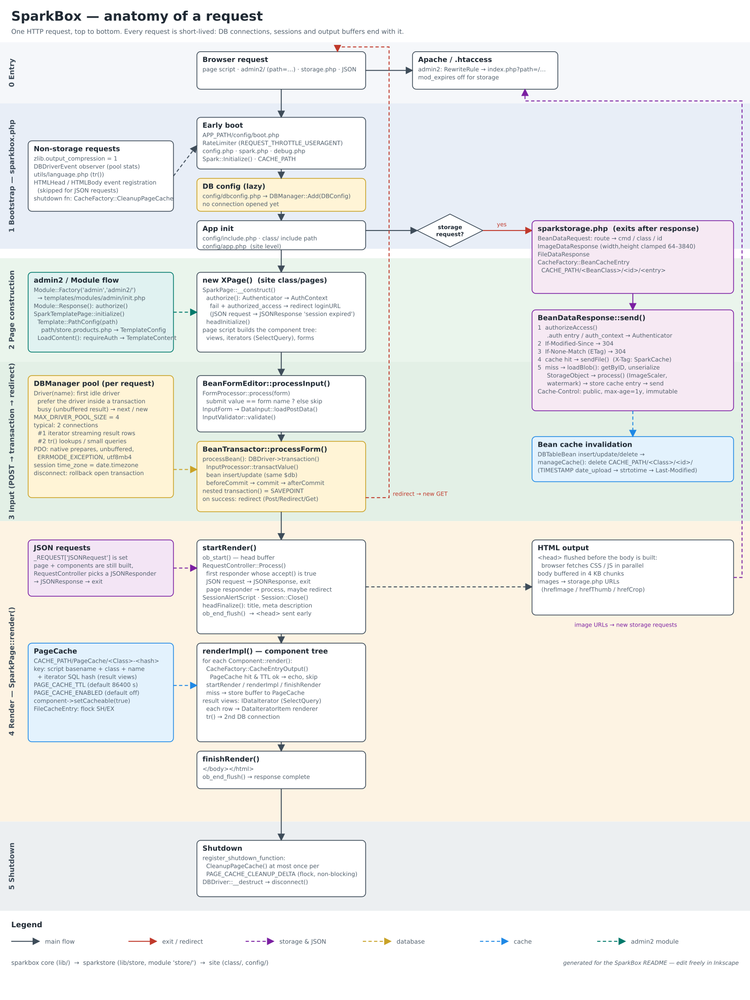
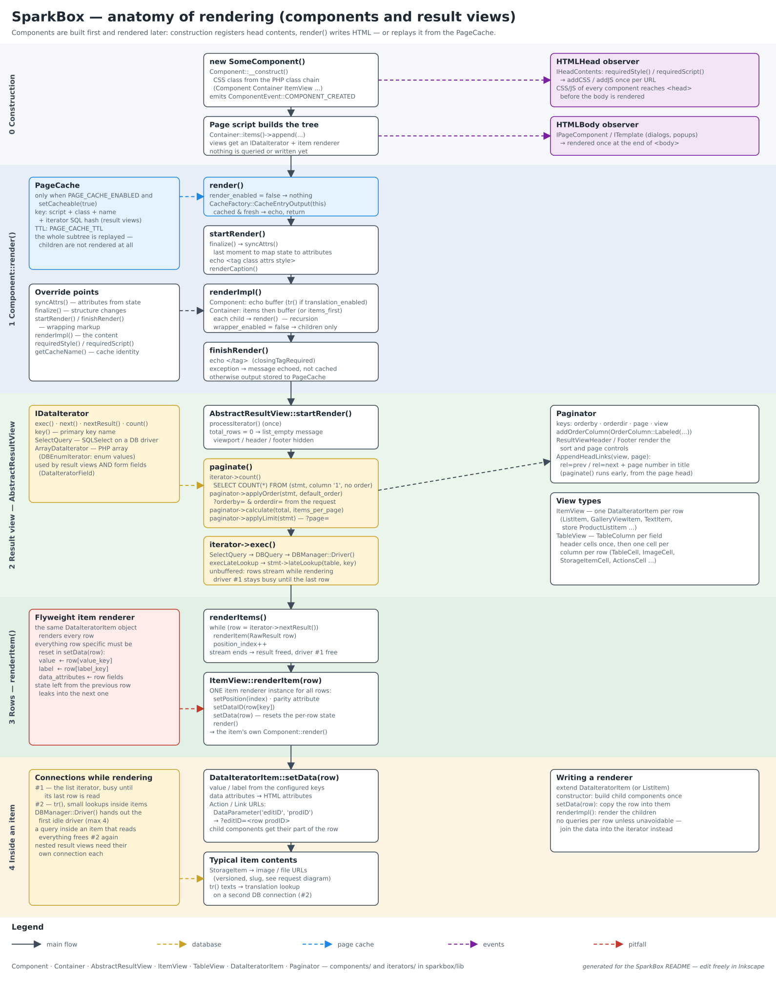
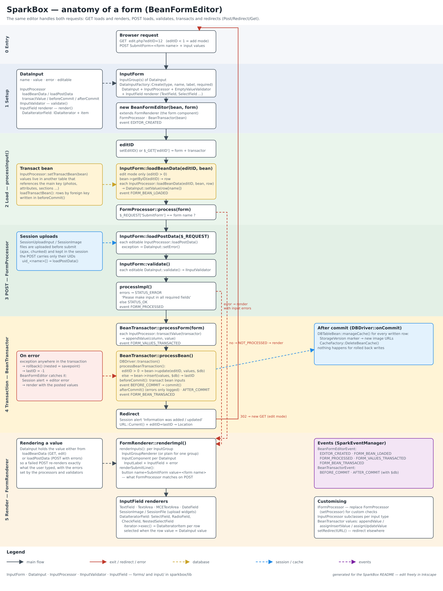

SparkBox
========

PHP object-oriented library for building CMS, web portals and web applications.

SparkBox is the core layer. It is used as is by sites, and as the base of **sparkstore**
(e-commerce layer, separate repository). A site sits on top of one or both:

```
site (APP_PATH)      class/, config/, page scripts, .htaccess
  └─ sparkstore      lib/store — products, cart, checkout, store admin   (module "store/")
      └─ sparkbox    lib — pages, components, forms, DB, SQL, storage, cache
```

Each layer is a separate checkout. A site points to SparkBox with `include_path`, sparkstore is added
to the include path from the site configuration.

Developed using [Kate](https://kate-editor.org/) and [PHPStorm](https://www.jetbrains.com/?from=sparkbox).


Requirements
------------

- PHP 8.3 or newer (typed class constants) — tested with 8.3, 8.4 and 8.5
- Extensions: pdo_mysql, gd, fileinfo, intl (transliteration of slugs), mbstring
- MariaDB or MySQL — load the time zone tables (`mysql_tzinfo_to_sql /usr/share/zoneinfo | mysql mysql`)
  so the DB session follows the configured PHP time zone
- Apache with mod_rewrite (`.user.ini` support for per-directory PHP settings)


Setting up a site
-----------------

1. Copy `user.ini.dist` to the document root as `.user.ini` and set
   `include_path` (SparkBox `lib`), `auto_prepend_file` (the site `sparkboot.php`) and `error_log`.
2. Copy `sparkboot.php.dist` to the document root as `sparkboot.php`. It defines `APP_PATH` and loads
   `sparkbox.php` — every request goes through it.
3. Create the configuration files in `APP_PATH/config/` (all optional except `dbconfig.php` when the
   database is enabled). They are loaded in this order:

| File | Purpose |
|---|---|
| `boot.php` | before anything else — `DEBUG_LEVEL`, request throttling (`dist/boot.php.dist`) |
| `settings.php` | `Spark::Set(Config::...)` values — site title, paths, caches, image scaler, mailer |
| `dbconfig.php` | `DBManager::Add(DBConfig)` connections (`dist/dbconfig.php.dist`) — keep out of git |
| `include.php` | extra include paths (e.g. sparkstore `lib`) |
| `app.php` | site initialisation after SparkBox is ready |

Site classes go to `APP_PATH/class/`, which is added to the include path — site code includes them as
`include_once("class/pages/MyPage.php")`.

Keep secrets (database, SMTP, payment providers) in files listed in `.gitignore`.


How a request works
-------------------



Every request is short lived: `sparkboot.php` → `sparkbox.php` bootstrap → configuration → either a
**storage request** (images and files, answered from the storage cache and exits) or a **page**:
the page object authorizes, the page script builds components, forms process their input,
and `SparkPage::render()` writes the HTML. The `<head>` is sent before the body is built.


Pages and components
--------------------



- `Component` — one HTML element. `render()` = `startRender()` (opening tag) → `renderImpl()` (contents)
  → `finishRender()` (closing tag). Override `syncAttrs()` / `finalize()` to map state to attributes
  and structure just before rendering.
- `Container` — a component with child components (`items()`).
- Components announce their CSS/JS with `requiredStyle()` / `requiredScript()`; `HTMLHead` collects
  them when the component is created.
- `AbstractResultView` (`ItemView`, `TableView`) — renders an `IDataIterator` (usually a `SelectQuery`)
  with paging and sorting (`Paginator`). **One** item renderer (`DataIteratorItem`) instance renders
  every row: everything row specific must be set in `setData($row)`.
- Components can be cached as HTML (`setCacheable(true)`, `PAGE_CACHE_ENABLED`).


Forms
-----



- `InputForm` holds `DataInput`s (created with `DataInputFactory`). Each `DataInput` has an
  `InputProcessor` (load and transact the value), an `IInputValidator` and an `InputField` renderer.
- `BeanFormEditor` edits one row of a `DBTableBean`: GET loads the row and renders the form, POST
  loads, validates, transacts in one DB transaction (`BeanTransactor`) and redirects back in edit mode.
- Values that live in other tables (photos, attributes) use a *transact bean* on the input processor.


Database
--------

- `DBManager::Driver()` returns a pooled `PDODriver` connection (native prepares, unbuffered results,
  `utf8mb4`, session time zone = PHP time zone). A connection streaming a result is busy — the pool
  hands out another one (usually at most two per request).
- Transactions nest: an inner `transaction()` is a savepoint, only the outermost `commit()` commits.
  `rollback()` outside a transaction is ignored. While a transaction is open, the pool returns its
  connection, and bean writes join it.
- `DBDriver::onCommit()` runs code after the outermost commit — used for cache invalidation.
- `DBTableBean` — one table: `getByID()`, `query()`, `insert()`, `update()`, `delete()`.


SQL builder
-----------

`SQLSelect`, `SQLInsert`, `SQLUpdate`, `SQLDelete` build statements from columns, clause collections
(`where()`, `having()`) and joins. Values are always bound — `match("price", 10, ">=")` adds a bound
clause; the same column with the same operator replaces the clause, a different operator adds one.

`SQLSelect::lateLookup($table, $key)` (`SelectQuery::$execLateLookup`) runs the filtering, ordering
and paging on the key only and reads the selected columns for the found rows. The selected columns
must be readable from `$table` — qualify them with the table name.


Storage and caching
-------------------

- Blob columns (images, files) are served by `storage.php` — query style
  `?cmd=image&class=ProductPhotosBean&id=12&width=640&height=640` or slug style
  `/assets/image/ProductPhotosBean/12/640/640/<version>/<name>.12.webp` (`STORAGE_ITEM_SLUG`).
- `StorageItem` builds the URLs. Every URL carries a **version token** that changes only when the row
  is written through its bean (`StorageVersion` marker files next to the bean cache). Responses with
  the current token are cached by browsers for a year (`immutable`), outdated tokens get a 301 to the
  current URL, URLs without a token get one day.
- Generated images and files are cached in `CACHE_PATH/<BeanClass>/<id>/` (`STORAGE_CACHE_ENABLED`);
  writes through the bean clear them after commit.
- Rows with an `auth_context` column are authorized on every request and sent `private, no-cache`.


Admin and modules
-----------------

The admin is being reworked into modules (`admin2`): a module maps a linear list of path files
(`path/store.products.gallery.php`) to templates, so menus and sub-pages are plain files in one folder.
The same structure is planned for checkout. Work in progress.


Tests
-----

`tests/` holds regression tests for the core and a runner for site smoke tests — see
[tests/README.md](tests/README.md). Run `php tests/run.php` before pushing.


Diagrams
--------

The diagrams in `docs/` are plain SVG and can be edited in Inkscape. Each has a generator
(`docs/*.gen.py`, Python 3) that rewrites the SVG — easier for moving boxes than editing by hand.
