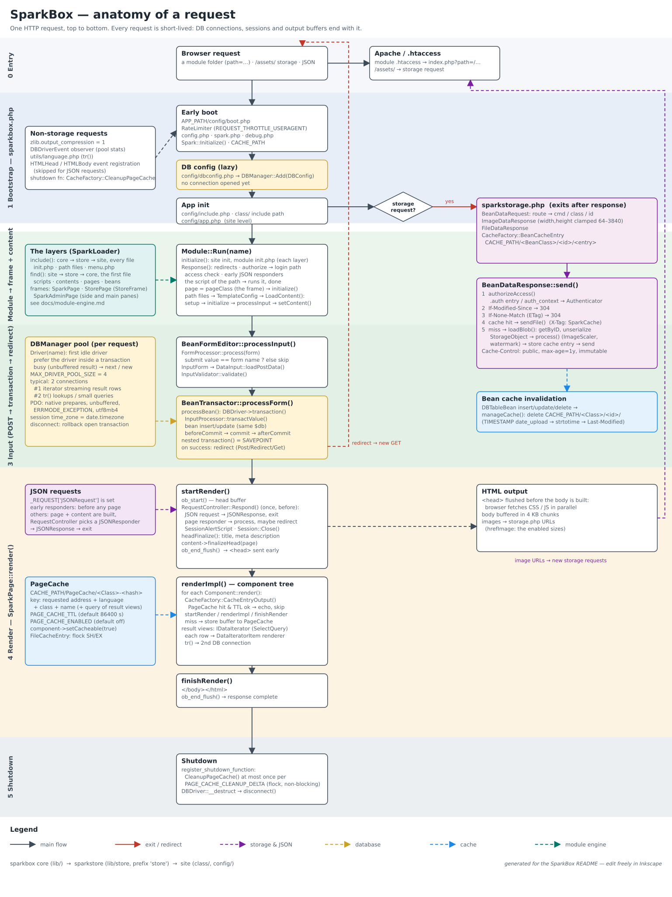

The module engine
=================

How a SparkBox site answers its pages: modules, path files, contents and frames. This is the reference
for writing a module, a content, or a site on top of the core and the store layer.

- [Layers and the search](#layers-and-the-search)
- [A module](#a-module)
- [The request, step by step](#the-request-step-by-step)
- [The site init](#the-site-init)
- [The module init.php](#the-module-initphp)
- [Path files](#path-files)
- [Scripts](#scripts)
- [Contents and their config](#contents-and-their-config)
- [Events: patching a path from a later layer](#events-patching-a-path-from-a-later-layer)
- [Frames](#frames)
- [Errors](#errors)
- [Strict includes](#strict-includes)
- [CSS: layers, tokens, one stylesheet per part](#css-layers-tokens-one-stylesheet-per-part)
- [Adding a module to a site](#adding-a-module-to-a-site)
- [Planned](#planned)


Layers and the search
---------------------

A site stacks up to three layers. Each one is a location of `SparkLoader`, which finds files by a prefix
relative to the location:

| Layer | Location | Loader prefix | Added by |
|---|---|---|---|
| core | `sparkbox/lib` | (none) | `sparkbox.php` |
| store | `sparkstore/lib` | `store` | the site `config/include.php` |
| site | `APP_PATH` | `class` | `sparkbox.php` |

So `templates/modules/news/init.php` is looked up as `sparkbox/lib/templates/modules/news/init.php`,
`sparkstore/lib/store/templates/modules/news/init.php` and `APP_PATH/class/templates/modules/news/init.php`.

Two ways to use the search:

- `SparkLoader::Factory($prefix)->include($name, true)` includes **every** file of that name, core first,
  the site last. Init files, path files and `menu.php` work this way: each layer adds to what the one
  before it did.
- `SparkLoader::Factory($prefix)->find($name)` returns the **most specific** file, site first. Scripts,
  contents, page classes, beans and authenticators work this way: a site file of the same name replaces
  the library one.

`instance($className, $type)` defines the class from `find()` and checks its type. Class names that come
from configuration or requests are validated before any constructor runs.


A module
--------

A module answers one top-level folder of the site (`/admin`, `/products`, `/news`; the site root is the
`main` module). There are no sub-modules. Its parts:

```
modules/<name>/index.php                       the entry: Module::Run("<name>")
modules/<name>/.htaccess                       rewrites the addresses to index.php?path=/<path>
templates/modules/<name>/init.php              the module settings (each layer)
templates/modules/<name>/path/<a.b.c>.php      one file per path: creates the config of its content (each layer)
templates/modules/<name>/content/<Class>.php   the contents of the module (most specific)
templates/modules/<name>/scripts/<path>.php    paths answered by a plain script (most specific)
templates/modules/<name>/menu.php              admin only: the menu (each layer)
```

The site links the module folder into its document root under any name. `Module::Run()` takes the
location from the requested script, so the same module works from `/admin2/` or `/admin/`. The module
`.htaccess` maps pretty addresses to `?path=` and the parameters they carry; the products module, for
example, maps `/<prodID>/<slug>/` to `path=/details&prodID=`.

The `main` module is the site root. `sparkbox/modules/main/root.htaccess` goes into the site's root
`.htaccess`: an address that is not a file or a folder goes to the root `index.php` as its path, and the
code folders `class/` and `config/` are refused.


The request, step by step
-------------------------

`Module::Run($name)`:

1. **`initialize()`** sets the active module, runs the **site init** once per request (`templates/init.php`
   of every layer), then the module `init.php` of every layer.
2. **`Module::Response()`**:
   1. **Redirects**: an old address of the module (`addRedirect`) answers 301 and stops. Then the trailing
      slash: with `noTrailingSlash`, `/authors/` answers 301 to `/authors`.
   2. **Authorize**: with an `authClass`, the authenticator gives the context. A path that is not public
      redirects to `loginPath` before any path file runs. An authorized request then goes through
      `accessCheck`; denied, it goes to `home` with an alert.
   3. **Early responders**: for an authorized JSON request, a responder whose `EarlyProcessing()` is true is
      created by name (`responders/json/<Name>.php`) and answers before any page exists.
   4. **Script**: a path with a script (see [Scripts](#scripts)) runs it, and the request is done.
   5. **Page**: `pageClassFor($path)` gives the page class, which is created through the `pages` loader. The
      module look is applied (`addPageClass`, `addPageCSS`, `addPageMeta`), then `initialize()`.
   6. **Content**: a page that is an `IRequestProcessor` handles the path itself (`processInput()`). Any other
      page is a frame: `loadContent()` includes the path files (`Template::PathConfig`), creates the content
      of the active config (`Template::LoadContent`: setup → initialize → processInput, each one an event),
      and the frame gets it through `setContent()`.
   7. **`RequestController::Respond()`**: the responders created by the page and its content process the
      request (a JSON responder answers and exits, a form redirects), the session alert is added, and the
      session is closed. Nothing writes the session while rendering.
   8. **`render()`**: the head is finalized (title, description, then `finalizeHead()` of the content) and
      flushed up to `<body>` so the browser fetches css and scripts while the body is built.




The site init
-------------

`templates/init.php` of each layer (core, store, site) runs once per module request, before the module
`init.php`. It runs for every request: framed pages, JSON responders and scripts. It holds the site setup
that does not belong to one module and costs nothing to declare: query classes, default renderers,
discounts, and the store frame options.

Bookshop (`class/templates/init.php`):

```php
Cart::SetDefaultDiscount(new FixedDiscount());
SellableProducts::SetProductsSelect(new BookshopProductsSQL());
ProductsTape::SetDefaultItemRenderer(new BookshopListItem());
SellableItem::SetDefaultDataParser(new BookshopSellableDataParser());

StoreFrame::Stylesheet(Spark::Get(Config::LOCAL) . "/css/store.css");
StoreFrame::HomeAction("Начало", Spark::Get(Config::LOCAL) . "/");
StoreFrame::Disable(StoreFrame::PAGE_FOOTER);
```

Set options here; don't build components. The frame builds its sections only when a page is rendered.


The module init.php
-------------------

Each layer's `init.php` gets `Module::Active()` and sets it up. The core part sets defaults with
`if (!$module->pageClass)`. The store and the site override them, because they run later.

| Setting | Meaning |
|---|---|
| `pageClass` | the frame (or the whole page) of the module paths: `SparkPage`, `StorePage`, `SparkAdminPage`, a site class |
| `authClass` | the authenticator; empty means a public module |
| `addPublicPath("login", ...)` | paths reachable without authorization |
| `loginPath`, `loginAlert` | where an unauthorized request goes, and the alert it sees (empty: none, e.g. the checkout cashier) |
| `accessCheck` | `fn(string $path): bool` after authorization (admin: limited roles) |
| `addPagePath($path, $class, $include)` | another page class for a path and the paths below it |
| `addPathAlias($old, $path)` | an old address answered as a module path, no redirect (`details.php` → `details`) |
| `addRedirect($old, $path)` | an old address answers 301 to a module path; the query is kept |
| `addScriptPath($path, $file)` | a path answered by a given script file |
| `noTrailingSlash` | single page modules (`main`): `/contacts`, not `/contacts/` |
| `addPageClass`, `addPageCSS`, `addPageMeta` | the module look: body class, stylesheet, meta of every page |

The products module (store) as an example:

```php
$module = Module::Active();
$module->pageClass = "StorePage";
$module->addPathAlias("details.php", "details");
$module->addRedirect("list.php", "");
$module->addRedirect("promo.php", "promos");
```

The page class is given **by name**, so a site can give the module a page class of its own
(`class/pages/<Name>.php`, found first).


Path files
----------

A path maps to one file name: `/store/products/gallery` is `path/store.products.gallery.php`, and the
module folder itself is `home.php`. Paths are lower case ASCII letters. Every layer's file of that name is
included, core first. A path file creates the **config** of its content, and the last config created is
the active one (`TemplateConfig::Active()`). No path file means 404 (`NotFound` content, `noindex`).

A path file is a factory call on its content class:

```php
<?php
include_once("class/templates/modules/products/content/BookshopProductList.php");
$config = BookshopProductList::Configure();
```

or a plain config with settings:

```php
<?php
//the Автори index - the values of the attribute 'Автор' (store AttributeIndex)
$config = TemplateConfig::Factory();
$config->contentClass = "AttributeIndex";
$config->title = "Автори";
$config->data = array("attribute" => "Автор", "letter" => "Буква", "placeholder" => "Търси автор ...");
$config->requireAuth = false;
```

A later layer's file of the same name either **replaces** the config (it calls a factory again) or
**patches** it: it takes `TemplateConfig::Active()` and changes its settings (`formClass`, `listFields`,
`searchField`, `beanClass`) or adds an observer (see [Events](#events-patching-a-path-from-a-later-layer)).
This is how a site customizes a store admin page without copying it.

`Template::DisablePath("/content/news")` (from `menu.php` or `init.php`) refuses a path and the paths
below it, and the admin menu drops them.

`Template::Condition()` carries the parent row of nested admin lists (a product's photos): a content with
`BeanConfig::$useCondition` filters its bean by it.


Scripts
-------

A path can be answered by a plain script that does all of its own work (headers, output). This is for the
site home, files (`sitemap.xml`, a logo), and page scripts not yet converted to contents. The script of a
path is `templates/modules/<module>/scripts/<path>.php` (the path keeps its dots: `sitemap.xml.php`; the
module folder is `home.php`). The most specific one runs, or the file given with `addScriptPath()`. It runs
after the redirects and the authorization, instead of the page.


Contents and their config
-------------------------

A content (`TemplateContent`) is the inner part of a frame: the component of the path and the work behind
it.

```
TemplateContent              config (TemplateConfig), component(), setup → initialize → processInput, finalizeHead
 └─ TemplateBeanContent      a content on a bean - BeanConfig; page actions and filters (IContentActions)
     ├─ BeanList, BeanTree, BeanGallery, BeanEditor, ConfigEditor     (templates/content - shared)
     └─ the module contents: ProductsList, OrderDetails, PublicationsContent ...
```

- **`Configure()`**: the static factory a path file calls. It creates the active config of
  `ConfigClass()` for this content class. A content with settings takes parameters and calls
  `parent::Configure()` first: `BeanList::Configure($beanClass)`, `BeanEditor::Configure($beanClass, $formClass)`,
  `Plain::Configure($title, $description)`. The path file includes the content class before it calls this.
- **`ConfigClass()`**: `TemplateConfig` by default; `BeanConfig` for bean contents. A content with more
  settings declares its own config class. `Template::LoadContent()` converts the active config to it
  (`From()`), so a path file may create a plain one.
- **`setup($config)`** stores the config and gives the default title. Bean contents also create the bean
  of `beanClass`.
- **`initialize()`** builds the component (`$this->cmp`).
- **`processInput()`** handles the request: forms, filters, paging. Responders created here process in
  `RequestController::Respond()`.
- **`finalizeHead($page)`** runs after the frame finalized its head (title, description); a paged list adds
  its prev / next links here.
- **`fallbackTitle()`** is the page title when neither the content nor the frame gave one.

`TemplateConfig` holds the generic settings: `contentClass`, `title`, `description`, `requireAuth`
(default true), `clearNavigation`, `observer`, and `data` (free settings documented by the content, e.g. the
attribute of `AttributeIndex`). `BeanConfig` adds `beanClass`, `formClass`, `configSection`, `listFields`,
`searchField`, `iterator` and `useCondition`.

The content class is looked up in the module's `content/` folder (site, store, core) and then in the shared
`templates/content` (Plain, NotFound, Bean*, ConfigEditor).

A content reads its data through its bean (`DBTableBean`: `getByID()`, `query()`) and the SQL builder. Clean
table relations are what let a bean list or editor work with no extra code: a foreign key column is a
list filter, a child table is a nested path with `useCondition`.


Events: patching a path from a later layer
------------------------------------------

`Template::LoadContent()` emits a `TemplateEvent` around each step of the content:
`CONTENT_CREATED`, `CONTENT_SETUP`, `CONTENT_INITIALIZED`, `CONTENT_INPUT_PROCESSED`. The `observer` closure
of the active config receives them. `TemplateConfigEvent::UPDATE` is emitted once the path files are all
included.

A later layer chains its observer with `TemplateConfig::WrapObserver()`, so the earlier one still runs:

```php
$config = TemplateConfig::Active();
$config->listFields = array("product_name" => "Title", "price" => "Price");
$config->observer = TemplateConfig::WrapObserver(function (TemplateEvent $event) {
    $content = $event->getSource();
    if (!($content instanceof ProductsList)) return;
    if ($event->isEvent(TemplateEvent::CONTENT_SETUP)) {
        $content->getIterator()->stmt->column("p.insert_date");
    }
    else if ($event->isEvent(TemplateEvent::CONTENT_INITIALIZED)) {
        $content->getItemActions()->getActions()->removeByAction("Variants");
    }
}, $config->observer);
```

Assigning `$config->observer` without wrapping replaces the earlier layer's observer. Do this only on
purpose (mobilevrati's brands list replaces the store columns).

In the store and site path files, prefer settings, then observers, then a content subclass, in that order.


Frames
------

A frame is the page class of a module: it holds the parts every page of the module shares, and gets the
content through `setContent()`.

**`SparkPage`** is the plain frame of the core modules: the default head (viewport, `SparkPage.css`, the
core scripts), the title and description, and the content component appended to the body. The body gets
the classes `<PageClass> <module> <path>` (`StorePage products category`; the site home is
`<PageClass> main home`, the root of any other module `<module> index`) and a `path` attribute.

**`StorePage`** (store) is the frame of the store modules. Its sections come from **`StoreFrame`**, which
the site configures in its site init:

```php
StoreFrame::Stylesheet(Spark::Get(Config::LOCAL) . "/css/store.css");        //the site css of the frame
StoreFrame::Header()->setVideo(Spark::Get(Config::LOCAL) . "/images/header_logo");
StoreFrame::Menu()->setCustomerGroup(false);
StoreFrame::Menu()->setSearchPlaceholder("Търси ...");
StoreFrame::Disable(StoreFrame::PAGE_FOOTER);
StoreFrame::HomeAction("Начало", Spark::Get(Config::LOCAL) . "/");            //the first breadcrumb item
StoreFrame::Use(StoreFrame::HEADER, MyHeader::class);                         //a section of its own
```

The sections are `HEADER`, `MENU`, `PAGE_FOOTER`, `FOOTER` and `COOKIES`. Each is a `StoreSection`: its
constructor only takes options, and `fill($content, $page)` builds it when the frame renders. Each has
its stylesheet (`storefront/css/frame/<Section>.css`); a site section adds its own with `stylesheets()`.
`StorePage` also gives the contents the logged client (`getClient()`, `StorePage::ClientContext()`), the
keyword search (`getKeywordSearch()`), the home action and the main section. A content in the store frame
can be a `Container`: its items become the columns of the main section.

**`SparkAdminPage`** (core admin) is the frame of the admin:

- the side pane (`AdminSidePane`: the administrator, logout, the menu);
- the main pane (`AdminMainPane`: page actions and title, filters, the help pane, the content).

A content that implements `IContentActions` fills the page actions and filters. The menu is built by
`menu.php` of every layer: the core creates it and `SparkAdminPage::SetMenu()` stores it; the store and the
site take `SparkAdminPage::Menu()`, extend it and set it again. `LoadMenu()` runs the menu files once per
request: for the page and for the role check of limited administrators. Roles are the English names of
the top-level menu items.

A site that wants another admin (or another storefront) writes its own page class and sets it as the
module `pageClass`. The frames are not extended through hooks.

A page that implements **`IRequestProcessor`** is not a frame: the engine calls its `processInput()`, and
it renders the path itself.


Errors
------

- An unknown path answers 404 with the `NotFound` content, `noindex`.
- A path file or a content that throws gives the error content of the path (`Plain`, `noindex`). The
  message is shown escaped; with debug enabled, the trace is added.
- A component that throws while rendering is replaced by `span.RenderError` with the message escaped,
  and the error is logged with the class, file and line.
- `display_errors` stays on: a visible error gets fixed.


Strict includes
---------------

Every file includes, with `include_once`, each class it uses with `new`, `::`, `extends` or `implements`.
The include path is the layer's, e.g. `include_once("store/beans/SellableProducts.php")`. A file must not
work only because another file happened to load the class first. Exempt: `instanceof` and `catch` (they
load nothing), and a use guarded by `class_exists("X", false)`. A class defined in more than one place (a
site bean of the same name) is not checked.

`tests/harness/includes.php` checks this for the core and the store (`tests/core/includes.test.php`), and
`php tests/check_includes.php <site root>` checks a site.


CSS: layers, tokens, one stylesheet per part
--------------------------------------------

`HTMLHead` declares the cascade layers first:

```css
@layer base, components, core, store, site;
```

A later layer wins whatever the selector specificity. Every stylesheet wraps its rules in its layer:

| Layer | What |
|---|---|
| `base` | element-only rules of every stylesheet (`body`, `h1`, `img`, `nav ul`): never above a class rule |
| `components` | the core building blocks, one stylesheet per component class (Action, ColorButton, InputField, TableView, MenuBar, the dialogs) |
| `core` | the core frames and module contents (SparkPage, SparkAdminPage and its panes, faq, news) |
| `store` | the store frame and its sections, the store components and modules (`storefront/css`) |
| `site` | the site css |

A frame, a module or a site adjusts a building block with a plain selector; it does not need a more
specific one. `!important` reverses the order between layers (an earlier layer's important wins), so it is
not used to override.

**Theme tokens** (`sparkfront/css/theme.css`, loaded on every page) are the palette and the font:
`--theme-font-family`, `--theme-text`, `--theme-background`, `--theme-accent`, `--theme-accent-light`,
`--theme-accent-dark`, `--theme-link`, `--theme-surface`, `--theme-error`. The store and the site set them in
their `:root`. **Component tokens** (`--spark-button-*`, `--spark-dialog-*`, `--spark-action-color`) belong to
their component and default to the theme; a site sets one only where that component differs.

There is no `@import`. Each part adds its own stylesheet: a component with `requiredStyle()`, a frame
section with `stylesheets()`, a module with `addPageCSS()`, a content through the page head.
`url()` paths are relative to the stylesheet's own folder.


Adding a module to a site
-------------------------

A site module (the site's own data, e.g. projects) is written in the site's `class/` folder; the core gets
nothing new:

1. **Tables and beans**: tables with clean relations (keys, foreign keys, child tables for photos) and a
   `DBTableBean` per table in `class/beans/`.
2. **Admin**: `class/templates/modules/admin/menu.php` adds the menu items to `SparkAdminPage::Menu()`.
   `class/templates/modules/admin/path/<item>.php` files configure the shared contents:
   `BeanList::Configure()`, `BeanEditor::Configure()` with an `InputForm` in `class/forms/`,
   `BeanGallery` for photos with `useCondition`.
3. **Frontend**: a module folder in the document root (`modules/<name>/index.php` with
   `Module::Run("<name>")` and its `.htaccess`); `class/templates/modules/<name>/init.php` (page class, page
   css); path files for the list and the details; contents in `content/` (a list on an `ItemView` of the
   bean's query, a details view of one row).
4. **Look**: the module stylesheet in the `site` layer, using the theme tokens.
5. **Checks**: `php tests/check_includes.php <site>` and a smoke test of the new paths.

A new module for every site goes into a layer instead: `templates/modules/<name>/` in the core or the
store, with `modules/<name>/` holding its entry.


Planned
-------

- **Frameless modules**: an empty `pageClass` answers the content as an HTML fragment or JSON (with the
  css / js its components need); a framed module answers one path as a fragment on request.
- **Plugins**: an optional piece installed on one deployment and not another. It is one more location
  between the store and the site, registered in that site's config, with its public files, a manifest
  and an init order. A site's own module is not a plugin.
